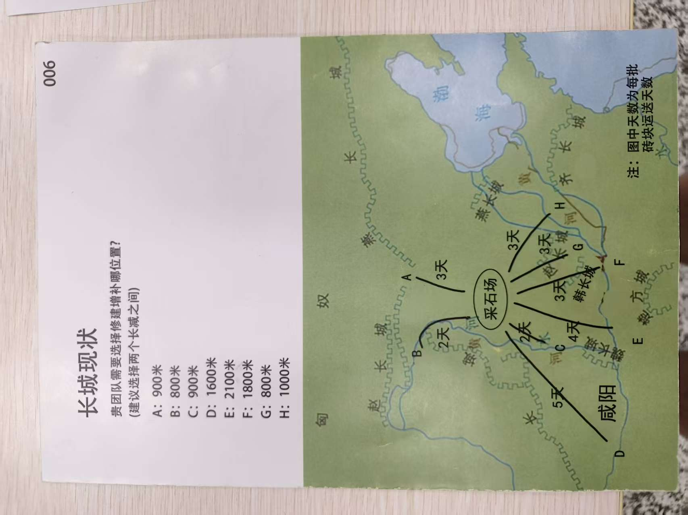

# 烽火长城 · Beacon Great Wall

> **Ancient Engineering Business Simulation** —— 以「为秦始皇修筑长城」为情境的商业沙盘模拟 / 团队竞赛项目，交付一份 **1700 米长城**的完整投标方案、成本报价与 3 分钟路演陈述。

| 项目要素 | 内容 |
| --- | --- |
| **项目名称** | 烽火长城（英文名 **Beacon Great Wall**，建议仓库名 `beacon-great-wall`） |
| **项目类型** | 古代工程背景的商业沙盘模拟 / 角色扮演式团队竞赛 |
| **课程背景** | 创新创业课程 · 团队方案路演与实训 |
| **核心任务** | 为秦始皇提供一段长城的修建方案与报价，并在 3 个月内完成修建 |
| **承接标段** | **A 段 900 米 ＋ B 段 800 米 ＝ 1700 米**（宽 6 米 × 高 6 米） |
| **交付口径** | 工期 **83 / 90 天**（余 7 天）｜全部投入 **1,651,560 / 2,000,000 秦半两**（结余 348,440） |

---

## 一、项目简介

秦始皇欲修长城以御匈奴，尚未决定是连接七国全部长城，还是只连接局部；若是局部修缮连接，选址亦须给出理由。他要求：**先给出一份完整报价**，并在 **3 个月内**看到修建结果。

本项目即针对这一情境给出的完整答卷 —— **选哪一段、怎么修、花多少钱、多久完工、突发状况如何应对**。

**三项交付要求：**

1. **决策建议** —— 连接所有七国长城，还是只连接局部？
2. **选址建议** —— 若为局部修缮连接，修在哪一段？必须给出理由。
3. **报价方案** —— 先给出一份完整报价，供秦始皇核算整体费用。

> **本组结论**：尽连七国，劳民而无益；**局部连缀 A 段 900 米 ＋ B 段 800 米**，省力而有功 —— 两段正当旧城之间，运距全场最短（B 段两日、A 段三日可达采石场），一旦连通即成一段连续防线。

---

## 二、成果速览（一页纸）

| 维度 | 结论 |
| --- | --- |
| 承接标段 | A 段 900 米 ＋ B 段 800 米 ＝ **1700 米**（宽 6 米 × 高 6 米） |
| 砖块总需求 | 城墙 **255 万块** ＋ 烽火台 **1.6 万块** ＝ **256.6 万块** |
| 供料结构 | 就近取土自制 **70 万块** ＋ 采石场外购 **185 万块**；**1000 名劳工** |
| 新增烽火台 | **4 座**（每 1000 米 2 座，4 × 4 × 4 米，**加建于墙体之上**，不占用地、不增运距） |
| 总工期 | **83 天**（施工 73 天 ＋ 瘟疫延期 10 天）／限 90 天，**余 7 天缓冲** |
| 工程报价 | **1,511,560 秦半两**（含 4 座烽火台 10,560） |
| 技能卡投入 | **140,000**（7 张：农具 ×1、糯米 ×1、砂浆 ×1、守卫 ×2、盔甲 ×2） |
| 合计支出 / 结余 | **1,651,560（82.6%）** ／ **348,440（17.4%）** |
| 执行记录 | **1 个 ×**（020 页试火，缺「火镰」，如实认账）；工期延期 10 天（018 页瘟疫，不购药） |
| 核心卖点 | **时间够、钱够、质量有保障、烽火台一步到位**，全程无返工 |

### 2.1 关键事件处置一览

| 页码 | 事件 | 我方处置 | 对报价 / 工期的影响 |
| --- | --- | --- | --- |
| **011** | 加造烽火台（竞标） | 加建 **4 座**（16,000 块砖），报价 **＋10,560** | 依「预算可适当增加」另行申报 **12,000 ～ 15,000** |
| **012** | 长城加宽（竞标） | 定性为**商人建议**；对甲方承诺**按 6 米交付**（4 米砖砌承重芯 ＋ 两侧就地取土夯筑加固层） | **不加价、不加期**（增量 40,800 两由结余自担） |
| **014** | 烽火燃料（竞标） | 四方案比选（狼粪／牛羊粪／杂草枯木枝／人粪）**仅留档** | **0**（试火失败后不再考虑燃料） |
| **018** | 瘟疫来袭（执行） | **不购药品**，接受延期 10 天 | 现金支出 **0**；工期 73 → **83 天** |
| **019** | 暴雨来袭（执行） | 1700 米**全程使用糯米砂浆** → **触发条件不成立** | **0 米冲毁／0 返工／0 追加／0 天** |
| **020** | 烽火台试火（执行） | 无「火镰」且场内无货 → **如实认账，记 1 个 ×** | 工期无影响；燃料成本随之取消 |

---

## 三、文档导航

| 编号 | 文档 | 内容概要 |
| --- | --- | --- |
| 01 | [项目简介](docs/01-项目简介.md) | 项目概述、游戏与成本规则、推算参考、技能卡清单、六大突发事件记录 |
| 02 | [预算规划（A ＋ B 方案）](docs/02-预算规划-A_B方案.md) | 成本明细、工时与工期、施工排程、预算对照、事件处置记录、十条执行原则 |
| 03 | [最终汇报文档](docs/03-最终汇报文档.md) | **最终汇报总纲**：一页纸总览 ＋ 全事件台账 ＋ 糯米砂浆专项 ＋ 3 分钟照读稿 ＋ 追问应答 |
| 04 | [致甲方演说稿](docs/04-致甲方演说稿.md) | 面向甲方（秦始皇）的 3 分钟商务陈述稿：6 米口径、技能卡双阶段用途、追问应答与数字速查 |
| — | [文档索引](docs/README.md) | 文档之间的关系、建议阅读顺序与资料图片对照表 |

> **建议阅读顺序**：本文 → `01 项目简介` → `02 预算规划` → `03 最终汇报文档` → `04 致甲方演说稿`。
> 时间紧张时，直接读 **`03 最终汇报文档`** 的「一页纸总览」与「3 分钟照读稿」，以及 **`04 致甲方演说稿`** 即可上场。

---

## 四、资料图片索引

### 4.1 项目手册（006 ～ 009 页）

| 页码 | 主题 | 文件 |
| --- | --- | --- |
| 006 | 长城现状：备选修缮段长度与地图（采石场、运送天数） | [`006-长城现状与选址地图.jpg`](assets/images/handbook/006-长城现状与选址地图.jpg) |
| 007 | 项目物资领取清单与角色卡分配 | [`007-物资领取清单与角色卡分配.jpg`](assets/images/handbook/007-物资领取清单与角色卡分配.jpg) |
| 008 | 游戏说明、汇报目标 | [`008-游戏说明与汇报目标.jpg`](assets/images/handbook/008-游戏说明与汇报目标.jpg) |
| 009 | 物料成本、劳力成本、长城规格 | [`009-物料成本与长城规格.jpg`](assets/images/handbook/009-物料成本与长城规格.jpg) |



### 4.2 事件卡（011 ／ 012 ／ 014 ／ 018 ／ 019 ／ 020 页）

| 页码 | 阶段 | 事件 | 文件 |
| --- | --- | --- | --- |
| 011 | 竞标 | 加造烽火台 | [`011-竞标-加造烽火台.jpg`](assets/images/events/011-竞标-加造烽火台.jpg) |
| 012 | 竞标 | 长城加宽 | [`012-竞标-长城加宽.jpg`](assets/images/events/012-竞标-长城加宽.jpg) |
| 014 | 竞标 | 烽火燃料 | [`014-竞标-烽火燃料.jpg`](assets/images/events/014-竞标-烽火燃料.jpg) |
| 018 | 执行 | 瘟疫来袭 | [`018-执行-瘟疫来袭.jpg`](assets/images/events/018-执行-瘟疫来袭.jpg) |
| 019 | 执行 | 暴雨来袭 | [`019-执行-暴雨来袭.jpg`](assets/images/events/019-执行-暴雨来袭.jpg) |
| 020 | 执行 | 烽火台试火 | [`020-执行-烽火台试火.jpg`](assets/images/events/020-执行-烽火台试火.jpg) |

> 图片命名规则：`页码-阶段-主题.jpg`（手册页为 `页码-主题.jpg`），详见 [CONTRIBUTING.md](CONTRIBUTING.md)。

---

## 五、目录结构

```text
烽火长城/
├── README.md                  # 项目说明（本文档）
├── CHANGELOG.md               # 版本记录：v1 → v3 → v3.1
├── CONTRIBUTING.md            # 协作与文档写作规范
├── LICENSE                    # 许可协议（CC BY-NC-SA 4.0）
├── .gitignore                 # Git 忽略规则
├── docs/                      # 全部文档
│   ├── README.md              # 文档索引
│   ├── 01-项目简介.md
│   ├── 02-预算规划-A_B方案.md
│   ├── 03-最终汇报文档.md
│   └── 04-致甲方演说稿.md
└── assets/                    # 静态资源
    └── images/
        ├── handbook/          # 项目手册截图 006 ～ 009
        └── events/            # 事件卡截图 011 / 012 / 014 / 018 / 019 / 020
```

---

## 六、关键数据速查

| 项目 | 数值 |
| --- | --- |
| 标段 / 规格 | A 900 米 ＋ B 800 米 ＝ **1700 米**；宽 **6 米** × 高 **6 米** |
| 砖块 | 城墙 **255 万块** ＋ 烽火台 **1.6 万块** ＝ **256.6 万块** |
| 单块成本 | 自制 **0.40 两/块**（0.24 ＋ 搬运 0.16）；外购 **0.66 两/块**（0.5 ＋ 搬运 0.16） |
| 供料 / 人力 | 自制 **70 万块** ＋ 外购 **185 万块**；**1000 名劳工**（8 两/天）；配送 **18.5 天**（10 万块/天上限） |
| 总工时 / 工期 | **72,800 劳工·天**；施工 **73 天** ＋ 瘟疫 **10 天** ＝ **83 / 90 天**（余 7 天） |
| 加宽增量（自担） | **20,400 m³** ／ **5,100 劳工·天（5.1 天）** ／ **40,800 两**，排在第 60 ～ 73 天收尾窗口 |
| 报价 / 全部投入 | 工程 **1,511,560** ／ 全部投入 **1,651,560**（＋自担加宽 40,800 ＝ 实耗 1,692,360） |
| 预算 / 结余 | **2,000,000** ／ **348,440 → 307,640**（自担加宽后） |
| 技能卡 | **7 张 / 140,000**（农具 ×1、糯米 ×1、砂浆 ×1、守卫 ×2、盔甲 ×2） |
| 事件记录 | 019 暴雨 **零损毁**；018 瘟疫 **延期 10 天、现金 0**；020 试火 **1 个 ×**（如实认账） |

---

## 七、关于项目名称

- **中文名**：烽火长城
- **英文名**：**Beacon Great Wall**（烽火 ＝ beacon，长城 ＝ the Great Wall）
- **建议仓库名**：`beacon-great-wall`

> 远程仓库当前名称为占位符 `----`。如需重命名，可在 GitHub 仓库页 `Settings → General → Repository name` 改为 `beacon-great-wall`（旧链接会自动重定向），随后本地执行：
>
> ```bash
> git remote set-url origin https://github.com/BOGNIN-AAA/beacon-great-wall.git
> ```
>
> 项目内部文档中的「烽火长城」名称与编号体系**不随仓库重命名而改变**。

---

## 八、参与与协作

- 项目成员请先阅读 **[CONTRIBUTING.md](CONTRIBUTING.md)**，其中规定了文档结构、命名规范、口径纪律与提交信息格式。
- 对外表述须遵守**口径纪律**：全篇不出现"申请免除／请裁判通融"字样；暴雨事件只说"**我方长城全程使用糯米砂浆，不属事件卡所指对象**"（条件不成立），不说"请求豁免"。
- 任何口径变更请同步更新 **[CHANGELOG.md](CHANGELOG.md)**，并检查四份文档是否一致。

---

## 九、许可

本项目文档与资料图片采用 **[CC BY-NC-SA 4.0](LICENSE)**（署名 — 非商业性使用 — 相同方式共享）许可协议。
如需用于商业用途，请先与作者联系以获得授权。
